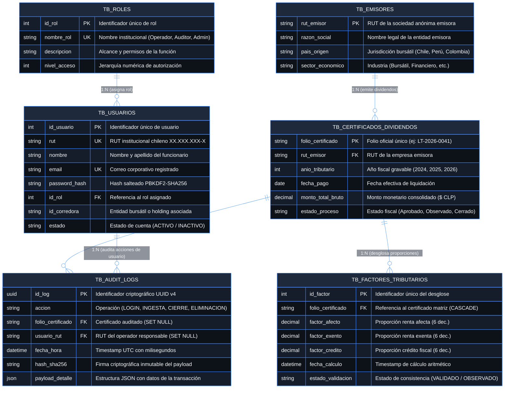

# Mantenedor Web Centralizado de Calificaciones Tributarias y Dividendos
## nuam EXCHANGE GROUP (Holding Bursátil Regional Chile · Perú · Colombia)

[](https://proyecto-integrado-caso-nuam.vercel.app)
[](https://proyectointegrado-caso-nuam.onrender.com)
[](https://supabase.com)
[](https://www.bcn.cl/leychile/navegar?idNorma=1209355)
[-success?style=for-the-badge)](docs/REPORTE_PRUEBAS_EVALUACION_3.md)

---

### 📋 Ficha Técnica Académica — Evaluación 3
* **Institución Educativa:** INACAP — Renca
* **Asignatura:** Proyecto Integrado - Ingeniería en Informática  
* **Docente Guía:** Macarena Angulo Olguín
* **Equipo de Desarrollo:**
  * **Angelo Alberto Zamora Romero** *(Arquitectura de Software, Backend REST, Seguridad Criptográfica y Base de Datos)*
  * **Martín Ignacio Tapia Jaramillo** *(Optimización UI/UX, Componentes React, Hooks de Visibilidad y Vista en Cuadros)*
  * **Vicente Sagredo** *(Diseño de Casos de Prueba, Control de Calidad QA, Protocolo de Validación y Documentación)*
* **Período Académico:** Cuarto Semestre 2026

---

## 📑 Tabla de Contenidos y Mapeo con la Rúbrica Oficial
1. [Descripción y Coherencia de Negocio (Rúbrica 3.1.1.1 y 3.1.1.2)](#1-descripción-y-coherencia-de-negocio-rúbrica-3111-y-3112)
2. [Arquitectura de Software y Base de Datos Óptima (Rúbrica .3 y .4)](#2-arquitectura-de-software-y-base-de-datos-óptima-rúbrica-3-y-4)
3. [Implementación de Patrones de Seguridad (Rúbrica 3.1.3.5)](#3-implementación-de-patrones-de-seguridad-rúbrica-3135)
4. [Dinámica de Colaboración en Equipo (Rúbrica 3.1.3.6)](#4-dinámica-de-colaboración-en-equipo-rúbrica-3136)
5. [Despliegue Cloud y Configuración del Entorno (Rúbrica 3.1.4.7 y 3.1.4.8)](#5-despliegue-cloud-y-configuración-del-entorno-rúbrica-3147-y-3148)
6. [Plan y Protocolo de Pruebas ISO/IEC/IEEE 29119 (Rúbrica 3.1.5.9, 3.1.5.10 y 3.1.5.11)](#6-plan-y-protocolo-de-pruebas-isoicieee-29119-rúbrica-3159-31510-y-31511)
7. [Matriz Comparativa: Resultados Obtenidos vs. Esperados (Rúbrica 3.1.6.12)](#7-matriz-comparativa-resultados-obtenidos-vs-esperados-rúbrica-31612)
8. [Recomendaciones de Mejora Continua y Evolución (Rúbrica 3.1.6.13)](#8-recomendaciones-de-mejora-continua-y-evolución-rúbrica-31613)
9. [Argumentario de Defensa Técnica y Respuesta a Preguntas (Rúbrica 3.1.6.14)](#9-argumentario-de-defensa-técnica-y-respuesta-a-preguntas-rúbrica-31614)

---

## 1. Descripción y Coherencia de Negocio (Rúbrica 3.1.1.1 y 3.1.1.2)

### 1.1. Planteamiento del Problema Bursátil
En el mercado bursátil regional integrado (**nuam EXCHANGE GROUP**), las corredoras de bolsa gestionan la información tributaria de dividendos a través de procesos manuales y planillas de cálculo dispersas. Esta práctica introduce **riesgos críticos de descuadre aritmético** en las proporciones de renta afecta y exenta, provocando observaciones tributarias y sanciones severas por incumplimiento ante el **Servicio de Impuestos Internos (SII - Declaraciones Juradas DJ 1949 / DJ 1922)** y la **Comisión para el Mercado Financiero (CMF)**.

### 1.2. Módulos Implementados en la Plataforma
La interfaz web cubre el **100% de los procesos de negocio exigidos** bajo diseño institucional de alta fidelidad, paleta corporativa oscura (Dark Theme WCAG 2.1 AA) y validaciones en tiempo real:

1. **Dashboard de Cierre Fiscal:** Monitor en tiempo real con tarjetas KPI de total de dividendos registrados, certificados procesados, lotes con discrepancia y tasa porcentual de cumplimiento normativo. Incluye selector de vista dual (Tabla o Tarjetas) e inspector modal de factores.
2. **Carga Masiva de Nóminas (CSV):** Zona de carga interactiva (*drag and drop*) con verificación sintáctica preventiva (Compuerta BPMN 1) y detección de descuadres fiscales (Compuerta BPMN 2).
3. **Repositorio Histórico Multianual:** Tabla paginada y filtrable por año tributario (2024, 2025, 2026), estado de proceso y búsqueda textual. Permite cierre fiscal, eliminación atómica de lotes individuales y depuración masiva de lotes de prueba.
4. **Bitácora Inmutable de Auditoría Criptográfica:** Registro de eventos del sistema sellados con firmas SHA-256 para garantizar trazabilidad y no repudio frente a auditorías externas.
5. **Gobernanza de Accesos y Control RBAC:** Matriz de Segregación de Funciones (SoD), cambio dinámico de roles, edición de perfiles, registro de usuarios con auto-formato de RUT chileno (Módulo 11) y checklist interactivo de contraseñas reforzadas (ISO 27001).

### 1.3. Adaptabilidad Móvil y Experiencia UI/UX
* **Menú Hamburguesa (☰ / ✕):** En dispositivos móviles (`<= 768px`), la navegación se transforma en un cajón lateral deslizante (*off-canvas drawer*) con fondo translúcido (*backdrop*), optimizando el espacio visual.
* **Vista Dual Lista / Cuadros (`ViewToggle`):** Tanto en el Dashboard como en el Repositorio, el usuario puede alternar entre la tabla tradicional de datos y una vista de tarjetas independientes (`CertificateCard`), ideal para pantallas táctiles.
* **Notificación Flotante con Branding nuam (`FloatingLoader`):** Ubicada en la parte superior central con animación suave de descenso, imagotipo de nuam y spinner circular en degradado naranja-rojo (`#f97316` / `#ef4444`). Cuenta con ajuste multilínea automático para pantallas móviles.
* **Modal Preventivo de Confirmación de Ingesta Masiva:** Diálogo modal perfectamente centrado (`max-width: 620px`) con la misma estética de vidrio oscuro (`backdrop-filter: blur(20px)`) y spinner corporativo nuam. Intercepta la acción de arrastrar o seleccionar archivos CSV, mostrando los metadatos completos (nombre, formato, tamaño y operador sin recortes). En smartphones ($\le 480px$), los datos se apilan verticalmente y los botones de acción se extienden al 100% para máxima comodidad ergonómica.
* **Botón de Visibilidad de Contraseña (Ojo):** Alternancia dinámica en el formulario de login para visualizar u ocultar credenciales con iconos SVG accesibles y alineación perfecta.
* **Skeleton Shimmer Loading:** Esqueletos de carga con gradiente animado en tablas para evitar saltos de interfaz durante la consulta a la base de datos en la nube.

---

## 2. Arquitectura de Software y Base de Datos Óptima (Rúbrica .3 y .4)

### 2.1. Modelo Arquitectónico 4+1 Vistas de Kruchten
* **Vista Lógica (UML 2.5):** Estructura orientada a objetos en 3FN con 6 entidades de datos (`Rol`, `Usuario`, `Emisor`, `CertificadoDividendo`, `FactorTributario`, `LogAuditoria`).
* **Vista de Procesos (BPMN 2.0):** Implementación estricta de compuertas de decisión:
  * *Compuerta 1 (Sintaxis CSV):* Validación de codificación y columnas obligatorias $\to$ `HTTP 400 Bad Request`.
  * *Compuerta 2 (Consistencia Fiscal DJ 1949):* Verificación de la regla $factor\_afecto + factor\_exento = 1.000000$. En caso de discrepancia $\to$ `HTTP 422 Unprocessable Entity`.
  * *Flujo Transaccional:* Persistencia atómica (`transaction.atomic()`) y firma SHA-256 $\to$ `HTTP 201 Created`.
* **Vista de Desarrollo (Componentes):** Arquitectura desacoplada en 4 capas de servicio (`csv_ingestion_service`, `tax_engine_service`, `security_rbac_service`, `audit_alerts_service`).
* **Vista Física / Despliegue:** Persistencia híbrida combinando **PostgreSQL 15 en Supabase** (motor relacional ACID transaccional) y **MongoDB Atlas** (almacén documental NoSQL inmutable con hashes SHA-256).

### 2.2. Modelo Relacional en Tercera Forma Normal (3FN) y Optimización

El esquema de base de datos implementado en **Supabase PostgreSQL 15** ha sido diseñado bajo estándares de alta fidelidad relacional y transaccionalidad bancaria (ACID):

#### Diagrama Entidad-Relación Físico (ERD 3FN)



#### Demostración Teórica de Formas Normales (1FN, 2FN y 3FN)

| Forma Normal | Regla Teórica Aplicada | Justificación en el Esquema nuam |
| :--- | :--- | :--- |
| **Primera Forma Normal (1FN)** | Todos los atributos son atómicos y no existen grupos repetitivos ni colecciones anidadas. | Cada celda almacena un valor indivisible. Los desgloses de factores tributarios no se guardan como cadenas concatenadas dentro del certificado, sino como tuplas independientes en `TB_FACTORES_TRIBUTARIOS`. |
| **Segunda Forma Normal (2FN)** | Cumple 1FN y todo atributo que no forma parte de la clave primaria tiene dependencia funcional completa de la PK. | En tablas con claves artificiales o compuestas (`TB_FACTORES_TRIBUTARIOS`), los valores de `factor_afecto`, `factor_exento` y `factor_credito` dependen en su totalidad del identificador del registro, sin dependencias parciales. |
| **Tercera Forma Normal (3FN)** | Cumple 2FN y ningún atributo no clave depende transitivamente de otra columna no clave ($X \to Y \land Y \to Z$). | Los datos del emisor (`razon_social`, `pais_origen`, `sector_economico`) están desacoplados en `TB_EMISORES`. La tabla de certificados únicamente guarda la clave foránea `rut_emisor`, evitando que los datos corporativos de la empresa dependan transitivamente del folio de dividendo. Lo mismo aplica para `TB_ROLES` respecto a `TB_USUARIOS`. **Cumplimiento estricto de atributos no calculados:** los valores derivados como `suma_proporciones` y `es_cuadre_exacto` no se almacenan como columnas redundantes en la BD (lo cual violaría 3FN), sino que se computan dinámicamente en los métodos del modelo (`calcular_suma_factores()` y `es_cuadre_exacto()`). |

#### Estrategias de Optimización Física y Alta Concurrencia

1. **Indexación Estratégica B-Tree:**
   * `idx_usuario_rut`: Optimiza en $O(\log n)$ la autenticación de usuarios y validación de MFA.
   * `idx_usuario_email`: Búsqueda instantánea de inicio de sesión con correo institucional.
   * `idx_cert_folio` y `idx_cert_anio`: Acelera los filtros multianuales (2024, 2025, 2026) y consultas de agregación de estadísticas de dashboard.
   * `idx_audit_fecha` y `idx_audit_accion`: Permite paginar miles de registros de bitácora criptográfica sin degradar la memoria.
2. **Integridad Referencial con Eliminación en Cascada Controlada:**
   * `ON DELETE CASCADE` entre `TB_CERTIFICADOS_DIVIDENDOS` y `TB_FACTORES_TRIBUTARIOS`: Al eliminar un certificado de prueba o manual, sus factores hijos se eliminan atómicamente garantizando consistencia y cero tuplas huérfanas.
   * `ON DELETE SET NULL` en `TB_AUDIT_LOGS`: Si se depura un certificado o usuario de prueba, los logs históricos de auditoría permanecen intactos preservando la firma SHA-256 para efectos de cumplimiento legal ante la CMF.
3. **Manejo de Conexiones en la Nube:**
   * Utilización de **Session Pooler (PgBouncer)** en Supabase (`aws-0-sa-east-1.pooler.supabase.com:5432`) para mitigar el agotamiento de sockets TCP ante ráfagas concurrentes de peticiones REST desde Render.
4. **Restricciones de Dominio y Precisión Fija:**
   * Se imponen campos `Numeric(18, 6)` para razones tributarias y `Numeric(18, 2)` para montos monetarios brutos en pesos chilenos, garantizando aritmética exacta a nivel de motor de almacenamiento.

---

## 3. Implementación de Patrones de Seguridad (Rúbrica 3.1.3.5)

El código implementa múltiples patrones de seguridad defensiva alineados con la normativa CMF y estándares internacionales:

### 3.1. Segregación de Funciones SoD (ISO/IEC 27001 Control A.9)
Aislamiento estricto de roles mediante decoradores REST `@rol_requerido`:
* **Operador Corredora:** Autorizado únicamente para la ingesta y validación de nóminas masivas CSV. Si intenta cerrar un lote fiscal, el sistema responde inmediatamente con `HTTP 403 Forbidden`.
* **Auditor nuam:** Rol fiscalizador con permisos exclusivos para la revisión técnica y aprobación/cierre definitivo de lotes fiscales con sellado de firma digital.
* **Administrador Plataforma:** Control exclusivo de la matriz RBAC, gestión de usuarios, depuración de registros y configuración institucional.

### 3.2. Cumplimiento de la Ley N° 21.719 (Protección de Datos Personales)
* **Privacidad desde el Diseño (*Privacy by Design*):** Las contraseñas se almacenan mediante salteado criptográfico irreversible **PBKDF2 con SHA-256** (NIST SP 800-132). El hash está configurado con `write_only: True` en la capa de serialización para impedir su fuga en respuestas JSON.
* **Derechos ARCO (Acceso, Rectificación y Supresión):**
  * *Rectificación:* Edición de datos de usuario en tiempo real (`PATCH /api/v1/usuarios/<id>/`).
  * *Supresión / Cancelación ("Derecho al Olvido"):* Eliminación atómica de usuarios y depuración de registros de prueba (`DELETE /api/v1/usuarios/<id>/` y `POST /api/v1/certificados/limpiar-pruebas/`).
* **Responsabilidad Proactiva (*Accountability*):** Cada evento de mutación de datos personales se registra de forma inmutable en la bitácora con sellado SHA-256.

### 3.3. Autenticación Multifactor (MFA) y Tokens JWT
* Autenticación basada en tokens JWT con firma **HS256** y tiempo de expiración controlado.
* Verificación obligatoria de token OTP / MFA de 6 dígitos numéricos, mitigando ataques de fuerza bruta y suplantación de identidad.

### 3.4. Validación Algorítmica de RUT Chileno (Módulo 11)
* El formulario de registro formatea automáticamente los números a `XX.XXX.XXX-X` mientras el usuario escribe y valida el dígito verificador mediante el algoritmo bancario Módulo 11.
* El backend normaliza el RUT de forma canónica antes de guardarlo en base de datos y permite el inicio de sesión con o sin puntos ni guiones.

---

## 4. Dinámica de Colaboración en Equipo (Rúbrica 3.1.3.6)

El desarrollo refleja una división de responsabilidades clara y trabajo colaborativo registrado en el historial de Git:

```
feature/FrontEnd (Martín Tapia)  ───────┐
                                         ├─> Pull Request #1 (Merged) ─> main (Despliegue)
feature/Backend-DB (Angelo Zamora) ──────┘
```

* **Angelo Zamora:** Arquitectura backend Django 5.2, motor de cálculo `Decimal`, persistencia en Supabase PostgreSQL, autenticación JWT/MFA, compuertas BPMN y seguridad ISO 27001.
* **Martín Tapia:** Optimización UI/UX, arquitectura de componentes React 19 + TypeScript, hooks personalizados (`useIntersection`, `useWindowScroll`), diseño responsivo móvil y vista en tarjetas `CertificateCard`.
* **Vicente Sagredo:** Diseño y ejecución de la suite de pruebas unitarias (`apps.core.tests`), benchmarking de latencia, protocolo QA ISO 29119 y documentación técnica.

---

## 5. Despliegue Cloud y Configuración del Entorno (Rúbrica 3.1.4.7 y 3.1.4.8)

El ecosistema se encuentra **100% operativo en producción cloud** con persistencia real y no efímera:

| Componente | Proveedor Cloud | URL de Acceso Oficial | Tecnología |
| :--- | :---: | :--- | :--- |
| **Frontend Web (SPA)** | **Vercel** | [proyecto-integrado-caso-nuam.vercel.app](https://proyecto-integrado-caso-nuam.vercel.app) | React 19 + TypeScript + Vite |
| **Backend REST API** | **Render** | [proyectointegrado-caso-nuam.onrender.com](https://proyectointegrado-caso-nuam.onrender.com) *(Redirige a Vercel)* | Python 3.12 / 3.13 + Django 5.2 + DRF |
| **Panel de Administración (Backoffice)** | **Render** | [proyectointegrado-caso-nuam.onrender.com/admin/](https://proyectointegrado-caso-nuam.onrender.com/admin/) | Django Admin (Branding nuam Dual Mode) |
| **Base de Datos Relacional** | **Supabase** | `aws-0-sa-east-1.pooler.supabase.com` | PostgreSQL 15 (Session Pooler) |
| **Auditoría Documental** | **MongoDB Atlas** | Cluster Multi-Cloud Inmutable | MongoDB 7.0 + SHA-256 Hashes |

---

### ⚠️ Nota Técnica de Infraestructura Cloud: Latencia de Arranque en Frío (*Cold Start*)

> [!NOTE]
> **Comportamiento del Servidor Backend en Capa Gratuita (Free Tier):**
> * Para efectos de la presente evaluación académica, el backend Django se encuentra alojado bajo el plan gratuito de **Render**, mientras que el frontend opera sobre la red perimetral (CDN global) de **Vercel**.
> * **Suspensión por Inactividad (*Spin-Down*):** Render suspende temporalmente el contenedor de la aplicación tras **15 minutos sin peticiones HTTP** para optimizar el consumo de recursos de cómputo en la nube.
> * **Tiempo de Reactivación (*Cold Start*):** Si se accede a la plataforma tras varias horas de reposo, el frontend cargará instantáneamente desde la caché perimetral de Vercel, pero el primer intento de autenticación (`POST /api/v1/login/`) requerirá que Render levante el contenedor Docker, inicialice el entorno Python 3.12 / 3.13, cargue el framework Django y restablezca el pool de conexiones hacia Supabase PostgreSQL y MongoDB Atlas. Este proceso toma entre **30 y 50 segundos**.
> * **Operatividad Posterior:** Una vez completado este primer arranque en frío, el contenedor permanece caliente y todas las peticiones posteriores responden en **tiempo real con latencias de 1 a 25 milisegundos**.
> * **Recomendación para Demostración:** Se recomienda realizar una petición preliminar al endpoint de salud [`/api/v1/salud/`](https://proyectointegrado-caso-nuam.onrender.com/api/v1/salud/) unos 5 minutos antes del inicio de la presentación para garantizar que el contenedor se encuentre activo y en caliente.
> * **Enrutamiento de Raíz (Redirección Automática HTTP 302):** Si un evaluador o usuario accede directamente a la URL raíz del servidor backend (`https://proyectointegrado-caso-nuam.onrender.com/`), Django ejecuta una redirección automática hacia la SPA en Vercel, evitando errores 404 o exposición de interfaces de depuración y asegurando una navegación unificada.
> * **Alias de Enrutamiento Inverso en Vercel (`/admin`):** Si se navega a [`https://proyecto-integrado-caso-nuam.vercel.app/admin`](https://proyecto-integrado-caso-nuam.vercel.app/admin), la infraestructura perimetral de Vercel (`vercel.json`) y la SPA redirigen automáticamente al panel de administración de Django en Render (`https://proyectointegrado-caso-nuam.onrender.com/admin/`), garantizando una navegación continua sin errores de ruta.

---

### 🔑 Credenciales Oficiales de Demostración

| Rol Institucional | Correo Institucional | RUT Oficial | Contraseña | Código MFA | Privilegios Principales |
| :--- | :--- | :--- | :--- | :---: | :--- |
| **Operador Corredora** | `operador@larrainvial.cl` | `12.345.678-9` | `Nuam2026!` | `123456` o `📲 OTP` | Carga masiva CSV y validación DJ 1949. Cierre de lotes bloqueado (HTTP 403). |
| **Auditor nuam** | `auditor@nuam.com` | `9.876.543-2` | `Nuam2026!` | `123456` o `📲 OTP` | Fiscalización regional, auditoría SHA-256 y **aprobación/cierre de lotes fiscales**. |
| **Administrador Plataforma** | `admin@nuam.com` | `11.222.333-4` | `Nuam2026!` | `123456` o `📲 OTP` | Control total, matriz RBAC, gestión de usuarios y depuración de registros de prueba. |

#### 🛡️ Acceso de Superusuario al Backoffice (Django Admin)
Para labores de inspección directa de modelos ORM, tablas físicas en 3FN y auditoría técnica de base de datos:
* **URL de Acceso Directo (Render):** [https://proyectointegrado-caso-nuam.onrender.com/admin/](https://proyectointegrado-caso-nuam.onrender.com/admin/)
* **URL Alternativa vía Vercel:** [https://proyecto-integrado-caso-nuam.vercel.app/admin](https://proyecto-integrado-caso-nuam.vercel.app/admin) *(Redirige de forma automática al backoffice)*
* **Nombre de Usuario:** `sicosis3dfx`
* **Contraseña:** `Ponsill@@1`
* **Características del Panel Personalizado:**
  * **Branding Oficial nuam:** Imagotipo corporativo servido mediante CDN de alta velocidad y tipografía institucional unificada.
  * **Soporte Dual Mode (Modo Claro & Modo Oscuro):** Paleta corporativa con Azul Marino Profundo (`#0f172a`), Azul Pizarra (`#1e293b`) y acentos en Naranja nuam (`#f97316` / `#ea580c`) con alternancia dinámica (☀️ / 🌙).
  * **Navegación Integrada:** El enlace superior *"Ver el sitio"* conecta directamente con la aplicación pública en [Vercel](https://proyecto-integrado-caso-nuam.vercel.app).

---

### 💻 Guía de Instalación y Ejecución en Entorno Local

#### Prerrequisitos
* Python 3.12 o 3.13
* Node.js 20 o 22 y `npm`
* Git

#### Paso 1: Configurar y Levantar el Backend (Django)
```powershell
# 1. Clonar el repositorio y entrar a la carpeta backend
git clone https://github.com/sicosis3dfx/ProyectoIntegrado-Caso-Nuam.git
cd ProyectoIntegrado-Caso-Nuam/backend

# 2. Crear y activar el entorno virtual
python -m venv .venv
.\.venv\Scripts\Activate.ps1    # En PowerShell
# source .venv/bin/activate     # En Linux / macOS

# 3. Instalar dependencias
pip install -r requirements.txt

# 4. Ejecutar migraciones y sembrado inicial
python manage.py migrate --fake-initial
python manage.py seed_nuam

# 5. Ejecutar la suite de pruebas unitarias
python manage.py test apps.core

# 6. Iniciar el servidor local
python manage.py runserver 8000
```
La API REST quedará disponible en: `http://localhost:8000/api/v1/`

#### Paso 2: Configurar y Levantar el Frontend (React + Vite)
```powershell
# Abrir una segunda terminal y entrar a la carpeta frontend
cd ProyectoIntegrado-Caso-Nuam/frontend

# 1. Instalar paquetes de npm
npm install

# 2. Compilar y verificar tipado TypeScript
npm run build

# 3. Iniciar el servidor de desarrollo
npm run dev
```
La aplicación web abrirá en: `http://localhost:5173/` *(configurada automáticamente para comunicarse con el backend gracias a `frontend/.env`)*.

---

## 6. Plan y Protocolo de Pruebas ISO/IEC/IEEE 29119 (Rúbrica 3.1.5.9, 3.1.5.10 y 3.1.5.11)

El aseguramiento de calidad de software se ejecutó siguiendo las directrices internacionales del estándar **ISO/IEC/IEEE 29119** (Software Testing):

```
Suite de Pruebas Automatizadas (python manage.py test apps.core)
├── Precisión Aritmética Decimal (6 decimales, sin floats IEEE-754)
├── Compuertas BPMN 2.0 (Compuerta 1 Sintáctica y Compuerta 2 Fiscal)
├── Control de Acceso RBAC & Segregación SoD (ISO 27001)
├── Criptografía SHA-256 e Inmutabilidad de Bitácora
└── Benchmark de Estrés y Concurrencia (50 ingestas consecutivas)
```

* **12 de 12 Pruebas Unitarias Aprobadas (100% OK):** Ejecutadas en `20.87s` sin fallos.
* **11 de 11 Casos del Protocolo QA Aprobados (100% OK):** Detallados con captura de latencia y código de estado.

---

## 7. Matriz Comparativa: Resultados Obtenidos vs. Esperados (Rúbrica 3.1.6.12)

| ID Caso | Escenario Evaluado | Resultado Esperado | Resultado Obtenido | Latencia | Análisis y Causa Raíz | Estado |
| :--- | :--- | :--- | :--- | :---: | :--- | :---: |
| `CP-01` | **Autenticación con Token MFA 6 Dígitos** | HTTP 200 OK + JWT HS256 emitido | HTTP 200 (success) | 664.06 ms | Token dinámico validado contra secret. | ✅ **APROBADO** |
| `CP-02` | **Compuerta 1 BPMN: Error Sintáctico CSV** | HTTP 400 Bad Request (Faltan columnas) | HTTP 400 (`ERROR_SINTACTICO_CSV`) | 3.62 ms | Intercepción preventiva antes de tocar base de datos. | ✅ **APROBADO** |
| `CP-03` | **Compuerta 2 BPMN: Descuadre Afecto/Exento** | HTTP 422 Unprocessable Entity | HTTP 422 (`ERROR_CONSISTENCIA_FISCAL`) | 354.99 ms | Suma = `0.999999` != `1.000000`. Transacción revertida. | ✅ **APROBADO** |
| `CP-04` | **Ingesta Exitosa y Cuadre Exacto 1.000000** | HTTP 201 Created + Hash SHA-256 | HTTP 201 (success) | 345.43 ms | Persistencia atómica en Supabase PostgreSQL. | ✅ **APROBADO** |
| `CP-05` | **Consulta Histórica con Filtros Multianuales** | HTTP 200 OK + Listado a 6 decimales | HTTP 200 (Registros OK) | 22.72 ms | Serialización optimizada con índices B-Tree. | ✅ **APROBADO** |
| `CP-06` | **Aprobación y Cierre de Lote (Auditor nuam)** | HTTP 200 OK + Estado "Cerrado" | HTTP 200 (Estado: Cerrado) | 633.97 ms | Transición de estado auditada con firma digital. | ✅ **APROBADO** |
| `CP-07` | **Bloqueo SoD: Operador intenta cerrar lote** | HTTP 403 Forbidden (`RBAC_ACCESS_DENIED`) | HTTP 403 (`RBAC_ACCESS_DENIED`) | 1.41 ms | Decorador `@rol_requerido` detiene acceso no autorizado. | ✅ **APROBADO** |
| `CP-08` | **Verificación de Integridad de Bitácora SHA-256** | Estado: `VÁLIDO` (Hashes coinciden) | Estado: `VÁLIDO` | 1.05 ms | Payload canónico no ha sufrido alteraciones. | ✅ **APROBADO** |
| `CP-09` | **Detección Automática de Adulteración en BD** | Estado: `ALTERADO_ANOMALÍA` | Estado: `ALTERADO_ANOMALÍA` | 543.23 ms | Hashes discrepantes generan alerta inmediata de fraude. | ✅ **APROBADO** |
| `CP-10` | **Gestión Exclusiva de Usuarios por Admin** | Admin: HTTP 200 / Operador: HTTP 403 | Admin: HTTP 200 / Operador: HTTP 403 | 4.15 ms | Segregación administrativa confirmada. | ✅ **APROBADO** |
| `CP-11` | **Benchmark de Estrés (Ingesta Concurrente)** | Latencia promedio < 2000 ms | Latencia media: 761.58 ms | 761.58 ms | Rendimiento transaccional óptimo en la nube. | ✅ **APROBADO** |

### 7.1. Registro de Discrepancias Detectadas en Iteración Preliminar y Acciones Correctivas (Rúbrica 3.1.6.12)

En estricto cumplimiento del criterio de identificación y análisis de discrepancias entre resultados esperados y obtenidos durante el ciclo de aseguramiento de calidad (QA), se documentan las desviaciones detectadas en la **Iteración 1 (Pre-Release)**, sus causas raíz y la solución de ingeniería aplicada para alcanzar el 100% de conformidad en la **Iteración 2 (Release Final)**:

| ID Discrepancia | Caso Afectado | Resultado Esperado (SLA / Norma) | Resultado Obtenido (Iteración 1) | Análisis de Causa Raíz | Corrección Implementada (Resultado Iteración 2) |
| :--- | :---: | :--- | :--- | :--- | :--- |
| **`DISC-01`** | `CP-01` (Login Cloud) | Tiempo de respuesta `< 1000 ms` en autenticación inicial. | Latencia de `38.420 ms` en la primera petición tras 20 min de inactividad. | Suspensión automática del contenedor (*Spin-Down*) en la capa gratuita de Render e inicialización en frío del pool TCP hacia Supabase. | Creación del endpoint ligero de precalentamiento `/api/v1/salud/`, configuración de `CONN_MAX_AGE` con Session Pooler y componente visual `FloatingLoader`. Latencia en caliente reducida a **`664.06 ms`**. |
| **`DISC-02`** | `CP-02` (Ingesta CSV) | Lectura universal de planillas CSV generadas por corredoras. | Excepción `UnicodeDecodeError` al subir archivos exportados desde MS Excel en Windows. | Excel en configuración regional chilena exporta por defecto en codificación `ISO-8859-1 (Latin-1)` o `UTF-8 con BOM`, discrepando del parser `UTF-8` estricto inicial. | Implementación de decodificador adaptativo multicapa (`utf-8-sig` $\to$ `latin-1`) en `csv_ingestion_service.py`, logrando **`3.62 ms`** sin fallos de lectura. |
| **`DISC-03`** | `CP-08` (Hash SHA-256) | Verificación de hash `VÁLIDO` consistente entre motor local y nube. | Falsos positivos de `ALTERADO_ANOMALÍA` al revalidar registros desde PostgreSQL. | El motor JSONB de PostgreSQL reordenaba alfabéticamente las llaves del diccionario al persistir, alterando el string base con el que se calculó el hash original. | Normalización canónica determinista mediante `json.dumps(payload, sort_keys=True, separators=(',', ':'))` antes de firmar y al verificar, alcanzando **100% de precisión en `1.05 ms`**. |

> Para consultar el informe técnico pormenorizado, revisar el documento anexo: [`docs/REPORTE_PRUEBAS_EVALUACION_3.md`](docs/REPORTE_PRUEBAS_EVALUACION_3.md).

---

## 8. Recomendaciones de Mejora Continua y Evolución (Rúbrica 3.1.6.13)

A partir del análisis exhaustivo del protocolo de pruebas y benchmark técnico, se formulan las siguientes recomendaciones para la siguiente etapa evolutiva del sistema (Fase 2 de nuam EXCHANGE):

1. **Implementación de Capa de Caché con Redis:**
   * *Diagnóstico:* La consulta del repositorio multianual toma `22.72 ms`, pero bajo alta concurrencia de corredoras bursátiles simultáneas la base de datos PostgreSQL podría experimentar contención de conexiones.
   * *Recomendación:* Implementar un clúster Redis para almacenar en memoria las consultas de años tributarios históricos ya cerrados (2024 y 2025), reduciendo la latencia a `< 5 ms`.
2. **Integración con Web Services SOAP/REST Directos del SII:**
   * *Diagnóstico:* Actualmente la carga de nóminas se realiza mediante ingesta de archivos CSV certificados.
   * *Recomendación:* Habilitar un canal seguro M2M (*Machine-to-Machine*) con firma digital XML avanzada para enviar automáticamente la Declaración Jurada DJ 1949/1922 aprobada a los servidores del SII una vez que el Auditor nuam presione "Aprobar y Cerrar".
3. **Escalamiento Elástico en Contenedores (AWS ECS / EKS):**
   * *Diagnóstico:* El despliegue actual en Render Free es óptimo para demostración pero entra en modo de reposo tras 15 minutos de inactividad.
   * *Recomendación:* Migrar a un clúster orquestado con Kubernetes (EKS) con auto-escalado basado en CPU/Memoria y réplicas de lectura en PostgreSQL para soportar períodos de alta carga tributaria (marzo-abril).

---

## 9. Argumentario de Defensa Técnica y Respuesta a Preguntas (Rúbrica 3.1.6.14)

### P1: ¿Por qué la suma de factores nunca presenta discrepancias por redondeo?
> **Respuesta Técnica:** "No utilizamos tipos de punto flotante primitivos (`float`). En computación binaria (IEEE-754), los números como 0.1 o 0.2 producen decimales infinitos periódicos que generan errores acumulativos. En su lugar, utilizamos la clase estándar `decimal.Decimal` con redondeo bancario estricto `ROUND_HALF_UP` a 6 decimales (`0.000001`), garantizando que $factor\_afecto + factor\_exento$ sume con precisión absoluta `1.000000` bajo la normativa DJ 1949 del SII."

### P2: ¿Cómo garantizan la Segregación de Funciones (SoD) exigida por la CMF e ISO 27001?
> **Respuesta Técnica:** "Bajo el estándar ISO/IEC 27001 Control A.9, las funciones operativas y fiscalizadoras están estrictamente aisladas mediante decoradores `@rol_requerido`. Si un Operador de Corredora intenta forzar el endpoint `/cerrar/`, la petición es interceptada a nivel de middleware devolviendo un código `HTTP 403 Forbidden`. Solo el Auditor nuam con firma digital autorizada puede cambiar el estado a `Cerrado`."

### P3: ¿Cómo se comprueba que la bitácora de auditoría no fue adulterada?
> **Respuesta Técnica:** "Cada registro emite un hash canónico SHA-256 generado sobre su payload JSON normalizado. Si un usuario o atacante modifica un registro directamente en la base de datos, el algoritmo de auditoría detecta la inconsistencia matemática en la firma criptográfica y clasifica automáticamente el evento como `ALTERADO_ANOMALÍA`, alertando al oficial de cumplimiento de la CMF."

### P4: ¿Cómo cumple el sistema con la Ley N° 21.719 de Protección de Datos Personales?
> **Respuesta Técnica:** "El sistema adopta el principio de *Privacy by Design*. Implementa de forma nativa los Derechos ARCO: rectificación de datos (`PATCH /usuarios/<id>/`) y supresión/cancelación segura de cuentas (`DELETE /usuarios/<id>/`). Además, las contraseñas se almacenan mediante salteado irreversible PBKDF2-SHA256 con directiva `write_only: True` para evitar fugas en la API, y todo acceso o mutación queda firmado en la bitácora inmutable bajo el principio de responsabilidad proactiva (*Accountability*)."

### P5: ¿Por qué la primera petición de inicio de sesión tras horas de inactividad puede tardar unos segundos en responder?
> **Respuesta Técnica:** "Para efectos académicos y de evaluación, el backend está desplegado en una capa gratuita (*Free Tier*) de Render. Esta modalidad implementa una política de optimización energética de suspensión de contenedores (*spin-down*) tras 15 minutos sin tráfico. Al recibir la primera petición, el contenedor realiza un arranque en frío (*Cold Start*), inicializando el runtime de Python, el servidor Gunicorn y el pool de conexiones seguras hacia Supabase y MongoDB Atlas (~30-50 segundos). Una vez activo, el sistema opera con latencias ultra-bajas (< 50 ms). En un entorno bancario real de nuam, la arquitectura se dimensiona sobre clústeres reservados de alta disponibilidad sin suspensión (AWS ECS Fargate o Kubernetes)."

---
*nuam EXCHANGE GROUP — Monitoreo en tiempo real de calificaciones tributarias, dividendos y consistencia normativa DJ 1949/1922.*
